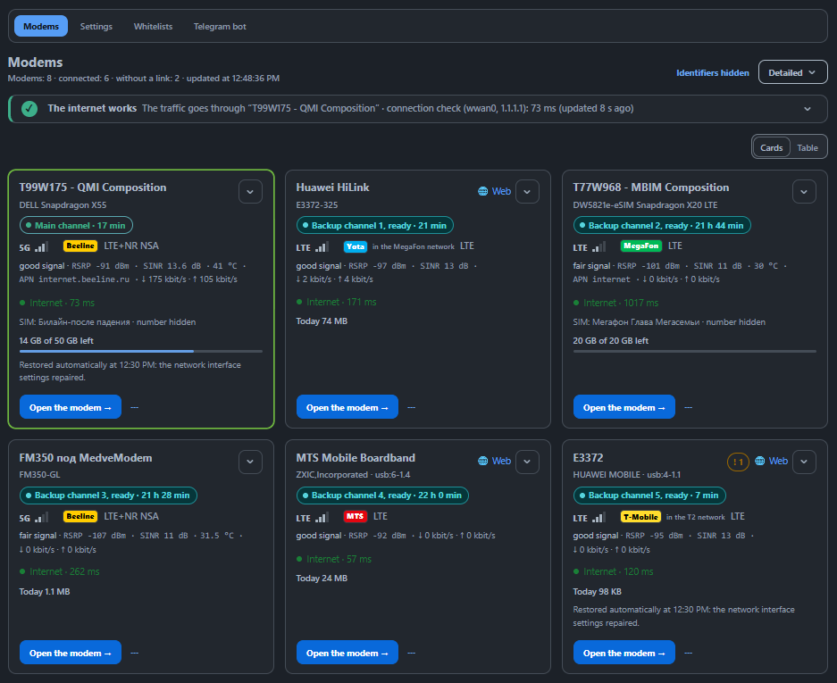
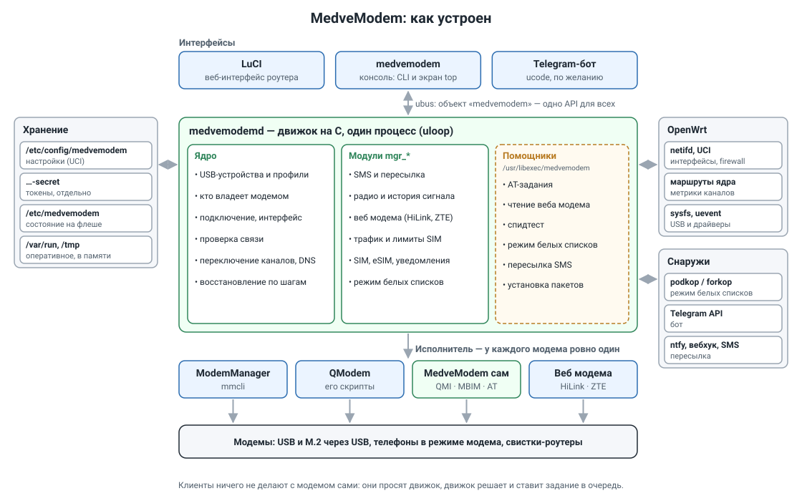
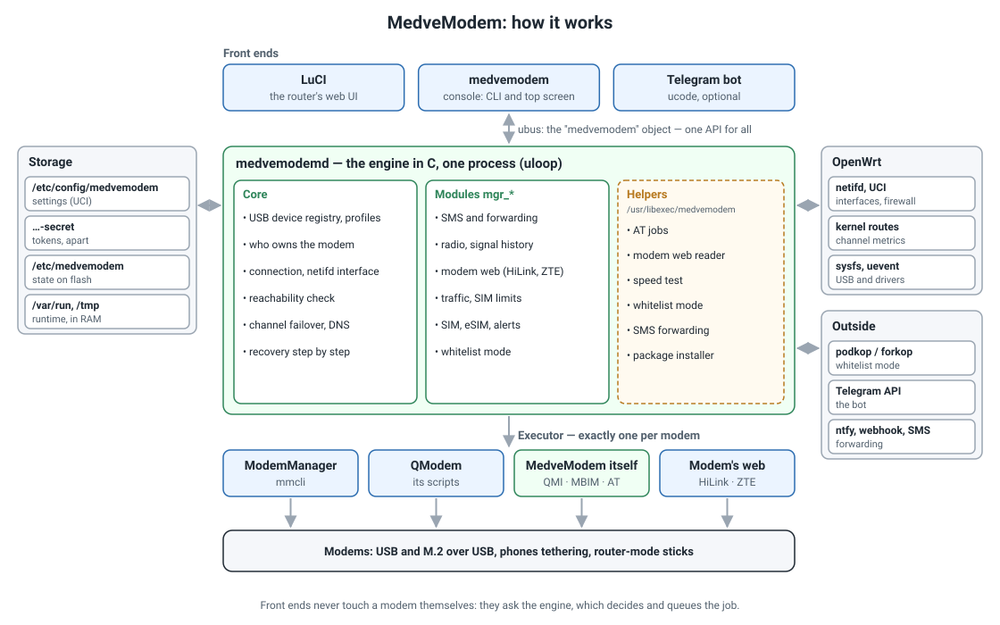

<div align="center">

# 🐻 MedveModem

**YAMMM - Yet Another MedveModem Manager**  
**A profile-driven, multi-modem orchestration engine for OpenWrt.**  

*Медвемодемный менеджер - управление USB-модемами, с резервированием каналов и восстановлением связи.*

[](https://github.com/Medvedolog/medvemodem/actions/workflows/build.yml)
[](LICENSE)


**[🇷🇺 Русский](#русское-описание) · [🇬🇧 English Quick Start](docs/USER-GUIDE.en.md) · [English overview](#english-overview)**

**RU: [Установка](docs/INSTALL.md) · [Краткая инструкция](docs/USER-GUIDE.md) · [Руководство](docs/MANUAL.md)**  
**EN: [Installation](docs/INSTALL.en.md) · [Quick Start](docs/USER-GUIDE.en.md) · [Full Manual](docs/MANUAL.en.md)**
**[Documentation / Документация](docs/README.md) · [Modem Zoo / Зоопарк модемов](docs/modem-zoo/README.md) · [ubus API](docs/UBUS-API.md) · [Releases](https://github.com/Medvedolog/medvemodem/releases)**

[Unknown modem / Неизвестный модем — отправить диагностику](#если-модем-неизвестен-или-не-работает--diagnostic-report) · [Report a bug](https://github.com/Medvedolog/medvemodem/issues/new) · [Build status](https://github.com/Medvedolog/medvemodem/actions) · [Source](https://github.com/Medvedolog/medvemodem)

**[Screenshots / Скриншоты интерфейса — 12 изображений](screenshots/README.md)**

[](screenshots/README.md)

</div>

> [!WARNING]
> **Alpha software / Альфа-версия.** Не устанавливайте на роутер без резервного способа доступа. CI artifacts are test builds, not a guarantee of production readiness.

## English overview

**[Quick Start (EN)](docs/USER-GUIDE.en.md) · [Installation (EN)](docs/INSTALL.en.md) · [Full Manual (EN)](docs/MANUAL.en.md)**

MedveModem is a modem orchestration engine for OpenWrt 24.10 / 25.12, with a C daemon, LuCI interface, CLI/TUI and optional Telegram bot. It coordinates modem ownership across ModemManager, QModem and native QMI/MBIM/AT paths; supervises connectivity, failover and staged recovery. The hardware knowledge base covers device profiles, modem-specific quirks and field reports.

**eSIM in Alpha 1:** Use **Diagnostics → Check for an eSIM** to detect an embedded eUICC or removable UICC/9eSIM; the **eSIM** tab reads EID and installed profiles and can **switch between existing profiles**. Until **Alpha 2**, download new profiles to the chip using a compatible phone and its card app (or EasyEUICC/OpenEUICC on Android). MedveModem does not yet download or delete eSIM profiles.


## Русское описание

# MedveModem

Менеджер USB-модемов для OpenWrt 24.10 и 25.12: движок, веб-интерфейс LuCI, консоль и Telegram-бот.

## Зачем

Модемом на роутере обычно пытаются управлять сразу несколько программ: ModemManager, QModem, хотплаг-скрипты.
Зачастую, они мешают друг другу, соревнуютсяя, связь рвётся, а причину не найти. MedveModem сам решает, кто ведёт каждый модем, и не пускает
к нему остальных. Он создаёт сетевой интерфейс, следит за связью и чинит её по шагам — от переподключения сессии
до сброса USB. Службу ModemManager сам движок не перезапускает — только по кнопке администратора; как именно он
обходится с ModemManager и QModem, описано в разделе [«Кто и когда трогает модем»](#кто-и-когда-трогает-модем).

Языки: LuCI — английский и русский (по языку LuCI), бот — русский или английский (в его настройках), консоль и
системный журнал — английский (`medvemodem top --lang ru` — по-русски).

## Как устроено



Движок `medvemodemd` — один процесс на C. LuCI, консоль и бот работают только через его API в ubus и сами модем не
трогают. Ядро движка находит модемы, назначает каждому одного владельца, держит подключение, проверяет связь,
переключает каналы и чинит связь по шагам; остальное (SMS, радио, веб модема, лимиты, режим белых списков) — в
отдельных модулях. Долгие и внешние действия выполняют помощники в отдельных процессах. Подробнее — в
[руководстве](docs/MANUAL.md), разделы 2 и 11.

## Что умеет

**Модемы и подключение**
- Узнаёт модем по профилю: 100 профилей — Foxconn T99W175, T77W968 (Dell DW5821e), T77W676, Fibocom FM350-GL и
  XMM, Quectel, Sierra EM74xx, SIMCom SIM7600, Telit FN990 и LM960, Huawei (в том числе HiLink E3372), ZTE,
  MegaFon MF150-4/M150-4, Yota (LU150, Gemtek WLTUBA), UFI-свистки (UZ801), телефоны Android и iPhone в режиме модема, а также общие профили QMI,
  MBIM, NCM и HiLink.
- Недостающее для модема (драйвер ядра, ModemManager, umbim/uqmi, usb-modeswitch) называет и ставит кнопкой;
  рядом — та же команда для SSH.
- Один владелец у модема: ModemManager, QModem или сам MedveModem напрямую (QMI через uqmi, MBIM через umbim,
  набор номера по AT). Выбор — по профилю модема или вручную, «Способ управления».
- Имя и настройки держатся за модемом после перезагрузки, переподключения USB и смены композиции: по серийному
  номеру, а у клонов без номера — по хэшу IMEI (сам IMEI не хранится).
- APN подбирается по SIM-карте; интерфейсы netifd создаются и меняются транзакциями с откатом. TTL 64 для
  тарифов «для смартфона», конфигурация USB модуля (QMI или MBIM у DW5821e).
- Порты модема получают роли (управление, AT, данные, служебные); в служебные порты AT никогда не шлётся, AT-порт
  выдаётся по аренде с проверкой владельца.
- Модемы-роутеры (Huawei HiLink, ZTE, MF150-4, UFI): сигнал, оператор, SMS, USSD и перезагрузка через их
  веб-интерфейс, сама страница открывается через роутер. Телефон в режиме модема — своей карточкой.
- Две SIM: переключение слота.
- Заморозка модема: ни одна служба его не трогает, пока его не разморозят.

**Несколько каналов**
- Приоритет модемов, «Сделать основным» без обрыва соединений.
- Переключение интернета на работающий канал (модем, провод, Wi-Fi) с проверкой доступности через каждый канал;
  DNS следует за трафиком; каналы «только вручную».
- Лимиты трафика SIM с предупреждением и переводом канала в резерв.
- Трафик и скорость каждого модема за 5 минут, час и сутки (средняя и пиковая); пик с загрузки роутера — в
  таблице каналов. Сколько модем был без интернета за день.

**Восстановление**
- Лестница шагов: обновить сведения → переподключить сессию → освободить порты → перезапустить поиск сети →
  перезагрузить модем → перезапустить драйвер → переподключить по USB → сбросить питание USB. Каждый шаг — только
  если профиль модема его разрешает, с лимитами и паузами.
- Распознаёт «белые списки» оператора, модем без SIM, зависший канал данных, нехватку питания USB, зависший
  драйвер USB-сети, сбои ядра роутера и не перезапускает модем, когда перезапуск не поможет.

**Сеть, сигнал, SMS**
- Режим сети и диапазоны с автоматическим откатом, если связь пропала; привязка к соте; история сигнала с лентой
  по несущим; агрегация, соседние соты, уровни по антеннам, температура модема.
- SMS (склейка длинных, вид мессенджера, адресная книга, экспорт, пересылка в бот, ntfy или webhook; заполненная
  память модема разгружается в архив на роутере) и USSD с кодами оператора; что модель не умеет (USSD у FM350),
  сказано заранее.
- **eSIM (встроенная eUICC, UICC/9eSIM):** на вкладке «Диагностика» есть кнопка «Проверить eSIM» для обнаружения чипа. Во вкладке «eSIM» можно прочитать EID, память и установленные профили, а также **переключиться на другой уже загруженный профиль**. До **Alpha 2** загрузку новых профилей на eUICC/UICC/9eSIM выполняйте через совместимый телефон и приложение карты (например, 9eSIM/eSIM.me, EasyEUICC или OpenEUICC на Android); загрузка и удаление профилей средствами MedveModem пока недоступны.

**Диагностика**
- Первое сломанное звено цепочки «устройство → SIM и сеть → сеанс → интернет → DNS».
- Проверка подмены DNS оператором и доступа к сервисам через конкретный канал; подсказки из журнала
  ModemManager; журнал событий модема.
- Отчёт для поддержки одной кнопкой: IMEI, ICCID, номера, тексты SMS и пароли в него не попадают. Если модель
  известна не полностью (общий или семейный профиль, профиля нет), карточка и страница модема так и говорят и
  предлагают собрать отчёт: в нём состав USB, решение движка и ответы модема на запросы модели и режима USB
  (только если AT-порт у MedveModem) — по нему добавляется профиль.

**Интерфейсы**
- **LuCI** («Модем» → «MedveModem»): обзор модемов карточками или таблицей с действиями над выбранными, страница
  модема с вкладками, настройки, три уровня подробности, переключатель «Скрыть идентификаторы», строка на модем
  в «Статус» → «Обзор».
- **Telegram-бот** (отдельный пакет, [описание](packages/medvemodem-bot/README.md)):
  оповещения и сводка за сутки, карточки модемов, входящие SMS, тест блокировок, журнал файлом; по желанию —
  управление модемами. Ходит в Telegram напрямую, через прокси (в том числе podkop) или через любой модем и при
  блокировке переключает маршрут.
- **Консоль**: команды `medvemodem` и экран `medvemodem top` (он же `medvemodem tui`) — см. [«Консольный экран»](#консольный-экран-medvemodem-top).

## Консольный экран `medvemodem top`

TUI для SSH и последовательной консоли: обычные ANSI-коды без curses, работает на любом роутере и в окне от
80 колонок. Всё берёт у движка через ubus, как LuCI: сам порты модема не открывает и ничего не определяет.
Обновляется каждые 2 секунды.

```sh
medvemodem top                  # все модемы (то же — medvemodem tui)
medvemodem top <device-id>      # сразу страница модема (Esc — выход)
medvemodem top --lang ru        # по-русски (или MEDVEMODEM_LANG=ru, или клавиша L на экране)
medvemodem top --once           # один кадр без управления терминалом — для скриптов и отчётов
```

Ключи: `--once` (в нём IMEI, ICCID, IMSI, номер, TAC и CID скрыты; показать — `--show-identifiers`),
`--no-color`, `--ascii` (без псевдографики), `--width N`.

**Список модемов** — приоритет, модем, состояние, оператор, сеть, роль (основной или резервный), сигнал.
- `↑↓` или `j`/`k` — выбор, `Enter` или `1`–`9` — открыть модем, `r` — обновить.
- `d` — активировать или деактивировать модем (отключение — с подтверждением).
- `z` — заморозить модем (с подтверждением) или разморозить.
- `[` `]` — переставить модем в приоритете, `P` — применить порядок, `Esc` — отменить. Первый — основной канал.
- `x` — исключения автопереключения: каналы (модемы, провод, Wi-Fi), которые автопереключение не делает
  основными. `Пробел`, `Enter` или номер — отметить, `P` — применить, `Esc` — выйти без сохранения. Если список
  тем временем поменяли в LuCI или в боте, черновик не применяется, а начинается заново с нового списка.

**Страница модема** — три вкладки, как в LuCI, переключаются `Tab` и `Shift-Tab`:
- «Обзор»: соединение и цепочка, адреса и шлюз, сеть, сигнал, последние события.
- «Радио»: сеть, сота, базовая станция и расстояние до неё по TA, несущие (агрегация), соседние соты, антенны,
  режим сети и диапазоны.
- «Сервис»: SIM, устройство (прошивка, IMEI, кто управляет), состояние восстановления и шаги `1`–`8`
  (недоступные для модема отмечены, всё, что рвёт связь, — после `y`), `M` — перезапустить ModemManager.
- `c` — проверить связь, `d` — активировать или деактивировать, `z` — заморозить или разморозить.
- `↑↓` — прокрутка, `Esc` — назад, `q` — выход, `L` — сменить язык.

SMS в консольном экране пока нет — они в LuCI и в боте.

## Кто и когда трогает модем

У каждого модема один владелец: ModemManager, QModem или сам MedveModem (QMI, MBIM, набор по AT). Остальных к
модему не пускают. Ниже — что именно происходит с каждой службой на всём пути: от загрузки роутера до остановки
движка.

**Загрузка и появление модема**
1. Роутер загружается. Если профиль модема запрещает ModemManager опрашивать служебные порты, ModemManager читает
   правило `/lib/udev/rules.d/78-mm-medvemodem.rules` (по серийному номеру USB) ещё до первого устройства.
2. Движок стартует, обходит USB, узнаёт модем по профилю и выбирает владельца. ModemManager к этому моменту может
   ещё запускаться: движок смотрит на него сразу и ещё дважды позже.
3. Если ModemManager успел занять порты модема, который ему не принадлежит (повтор событий из его кэша при старте),
   движок забирает эти порты обратно.

**Модемом владеет ModemManager**
- Интерфейс создаётся с `proto modemmanager` и `disable_modem 0`: при отключении интерфейса модем остаётся в
  сети, SMS и USSD работают.
- Если ModemManager так и не взял модем, движок ещё раз сообщает ему о портах — до трёх раз на одно подключение
  модема, не чаще чем раз в 30 секунд, и не пока ModemManager его опрашивает.
- Шаги восстановления «перезапустить поиск сети» и «перезагрузить модем» идут через ModemManager
  (`mmcli --disable/--enable`, `--reset`) и только для модемов, которыми он владеет.
- Шаги «перезапустить драйвер», «переподключить по USB», «сбросить питание USB» заставляют модем появиться
  заново; ModemManager находит его сам, как при подключении.

**Модемом владеет QModem или сам MedveModem**
- Пока ModemManager работает, на такой модем держится `mmcli --inhibit-device`, и ModemManager его не трогает.
  Если блокировка оборвалась, движок ставит её снова с паузой от 5 секунд до 5 минут.
- QModem: при смене настроек движок делает `qmodem_network reload` — набор других модемов не прерывается.
  Полный `restart` QModem рвёт все соединения вместе с LAN, поэтому он только по кнопке и после предупреждения.
- Если в секции QModem указан AT-порт другого модема, движок исправляет его и запускает набор заново.

**Заморозка**
- Движок перестаёт трогать модем: не подключает, не чинит, не шлёт AT, не трогает драйвер.
- QModem получает `enable_dial 0`, его процесс набора для этого модема убирается.
- ModemManager блокируется на этом модеме, а порты убираются из его кэша. Если модем переподключится по USB,
  скрипт hotplug уберёт порты снова раньше, чем ModemManager их опросит.
- После разморозки всё возвращается: QModem снова набирает, ModemManager снова узнаёт о портах.

**Перезапуск ModemManager**
- Сам движок его не перезапускает никогда: это задело бы все модемы на роутере.
- Администратор может перезапустить его кнопкой в настройках LuCI или клавишей `M` в `medvemodem top`, с подтверждением. Порядок: остановить, дождаться,
  пока старый процесс завершится (иначе новый простаивает около 95 секунд), запустить.
- Не чаще раза в 5 минут и не во время шага восстановления. После перезапуска автоматическое восстановление ждёт
  3 минуты, блокировки ставятся сразу заново.
- Установщик компонентов включает и запускает ModemManager, только если тот не работал; работающий не
  перезапускается.

**Выключение MedveModem**
- `service off`: движок останавливается и не стартует при загрузке; ModemManager и QModem продолжают работать и
  забирают модемы, как будто MedveModem нет.
- `service off others`: вместе с движком останавливаются и выключаются ModemManager и службы QModem. `service on
  others` запускает ровно те, что были остановлены.
- При остановке движка блокировки ModemManager снимаются, и ему заново сообщают о портах — модемы возвращаются к
  нему.

## Что проверено на стенде

Стенды автора и тестеров: Orange Pi Zero 3 и NanoPi R3S (OpenWrt 25.12, ModemManager 1.24), GL-MT6000 и другие
mediatek/filogic, Nokia XG-040G-MD (Airoha AN7581, снапшот), x86_64.

| Модем | Как работает | Итог |
|---|---|---|
| Foxconn T99W175 | QMI под ModemManager | подключение, сигнал с 5G, восстановление, SMS, USSD (в LTE — с уходом в 3G) |
| Dell DW5821e (T77W968) | MBIM под ModemManager | подключение, сигнал, SMS, USSD (в LTE — через AT) |
| Fibocom FM350-GL | сам MedveModem: набор по AT, данные по RNDIS | подключение, сигнал, SMS; USSD прошивка не поддерживает; нужен `kmod-usb-net-rndis` |
| Quectel EP06 | QMI под ModemManager | подключение, сигнал; USSD не подтверждён |
| Huawei E3372 (HiLink) | режим роутера | подключение, сигнал, SMS, USSD, перезагрузка через веб модема |
| MegaFon MF150-4 / M150-4, UZ801 | режим роутера | сигнал, оператор, SMS через веб модема |
| Huawei E171 | под ModemManager, после выхода из режима флешки | подключение (2G), SMS |
| ZTE MF100 (3G) | PPP под ModemManager 1.24 | подключение сразу после подключения модема, без ручных команд (r163) |
| Телефоны Android и iPhone | режим модема по USB | подключение, своя карточка |

Остальные модели из каталога опознаются и получают безопасные настройки; всё, что меняет модем, для них выключено
до проверки на стенде.

## Установка

Скачайте со страницы последней стендовой сборки архивы для своей линии OpenWrt и архитектуры
(`aarch64_cortex-a53`, `aarch64_generic`, `x86_64`):

- `medvemodem-<версия>-<архитектура>-<линия>.tar.gz` — движок, LuCI и lpac для eSIM;
- `medvemodem-bot-<версия>-<линия>.tar.gz` — Telegram-бот и его страница в LuCI (по желанию);
- `qmodem-3.3.0-<архитектура>-<линия>.tar.gz` — ядро QModem для FM350 и Quectel (можно поставить и позже из
  LuCI, «Настройки» → «Диагностика и компоненты»).

```sh
# OpenWrt 25.12 (apk)
tar xzf medvemodem-*.tar.gz && apk update
apk add --allow-untrusted ./medvemodem-0*.apk ./luci-app-medvemodem-*.apk
/etc/init.d/rpcd restart

# OpenWrt 24.10 (opkg)
tar xzf medvemodem-*.tar.gz && opkg update
opkg install ./medvemodem_*.ipk ./luci-app-medvemodem_*.ipk
```

`medvemodem-lpac*` из того же архива — только для eSIM. Всё, что нужно модемам, кроме самого MedveModem, ставится и из
LuCI без SSH: «Модем» → «MedveModem» → «Настройки» → «Диагностика и компоненты» — ModemManager, драйверы ядра,
umbim/uqmi, usb-modeswitch, qmi-utils и QModem, кнопками с журналом; сначала пробный прогон, работающий ModemManager
не перезапускается.

Движок и LuCI ставятся только парой одной версии. Новая сборка ставится поверх, настройки
(`/etc/config/medvemodem`) сохраняются.

Не ставьте MedveModem рядом с другими менеджерами модемов
(страница «Модемы» предупредит о них): два менеджера на
одном модеме мешают друг другу. QModem MedveModem ведёт сам.

## Первые шаги

- LuCI: «Модем» → «MedveModem» → «Модемы». Модем появляется сам; если интерфейса для него ещё нет, его создаёт
  кнопка «Подключить» (или автоподключение в «Настройках»).
- Консоль:

  ```sh
  medvemodem list                 # модемы и их device_id
  medvemodem show <device-id>     # всё о модеме
  medvemodem top                  # экран в реальном времени (TUI; --lang ru — по-русски)
  medvemodem events <device-id>   # журнал событий модема
  medvemodem diag profile <device-id> --stdout > report.json   # отчёт для разбора
  ```

## Если модем неизвестен или не работает / Diagnostic report

Если MedveModem **не распознал модель, определил её только по общему профилю или не может установить соединение**, отправьте диагностический пакет разработчикам — это помогает исправить профиль, обнаружить неподходящий драйвер или разобраться с ошибкой подключения.

1. Откройте LuCI: **«Модем» → «MedveModem» → выберите модем → «Диагностика» → «Отчёт о модеме» → «Собрать отчёт для разбора»**. Сохраните сформированный файл `.json` на телефон или компьютер.
2. Если LuCI недоступен, по SSH выполните `medvemodem list`, затем `medvemodem diag profile <device-id> --at --stdout > report.json` (замените `<device-id>` идентификатором модема из списка). Если модем вообще не обнаружен, укажите это в Issue и приложите доступные сведения об USB-устройстве и журнал ошибок.
3. **Откройте [GitHub Issues → «Новый модем»](https://github.com/Medvedolog/medvemodem/issues/new?template=new-modem.yml)**. Укажите модель и прошивку модема, модель роутера, версию OpenWrt и MedveModem, что работает и на каком этапе возникает ошибка.
4. **Прикрепите файл отчёта в поле «Отчёт»** через скрепку/перетаскивание. Если GitHub не принимает `.json`, упакуйте его в `.zip` и прикрепите архив. Дождитесь загрузки вложения, затем отправьте Issue. При необходимости дополните сообщение выводом `logread -e medvemodem` и `logread -e ModemManager`, предварительно проверив их содержимое.

Для незнакомой модели, если установлен `medvemodem-bench`, дополнительно можно приложить архив из `/tmp`, созданный командой `medvemodem-bench probe --at`: она только считывает сведения и не переключает режимы модема. Перед отправкой также проверьте содержимое архива.

Отчёт штатно скрывает IMEI, IMSI, ICCID, номера телефонов, пароли, PIN и тексты SMS, а серийный номер заменяет хешем. **Перед публикацией всё равно откройте файл и проверьте его: Issue и вложения публичны.** Не прикладывайте конфигурации с токенами или паролями.

*English:* If your modem is unknown, partially recognized or cannot connect, open **MedveModem → modem → Diagnostics → Modem report**, save the generated JSON, then [create a New modem issue](https://github.com/Medvedolog/medvemodem/issues/new?template=new-modem.yml) and attach the report (ZIP it if JSON attachments are rejected). Include your modem and router models, OpenWrt/MedveModem versions, symptoms and reproduction steps. **Review the report for sensitive data before submitting a public issue.**

## Чего пока нет

- eSIM: **загрузка новых и удаление имеющихся профилей непосредственно из MedveModem** (планируется в Alpha 2). **Обнаружение eSIM, чтение и переключение между уже записанными профилями доступны сейчас.**
- Вход в веб-интерфейс Huawei HiLink серии B с новым входом (RSA): модем отвечает «нужен пароль».
- SMS в консольном экране `medvemodem top`.

## Документация

- [Установка](docs/INSTALL.md) · [краткая инструкция](docs/USER-GUIDE.md) · [подробное руководство](docs/MANUAL.md);
- [История изменений](docs/CHANGELOG.md);
- [Сборка из исходников](docs/BUILDING.md);
- [ubus API движка](docs/UBUS-API.md);
- [Каталог модемов (Modem Zoo)](docs/modem-zoo/README.md): модели, композиции USB, AT-команды, заметки с форумов и
  из Telegram;
- [Архитектура профилей](docs/PLUGIN-ARCHITECTURE.md) · иерархия источников ·
  происхождение каталога;
- [Telegram-бот](packages/medvemodem-bot/README.md);
- [LuCI под любой темой](docs/LUCI-THEMES.md).

## Разработка

- Движок — C (libubox, ubus, uci, json-c), LuCI — JavaScript, бот — ucode.
- Пакеты собираются в официальном OpenWrt SDK: `tools/build.sh <архитектура> <версия>` ([BUILDING](docs/BUILDING.md)).
  GitHub Actions собирает их на каждый push в `main` и на каждый pull request для aarch64_cortex-a53, aarch64_generic
  и x86_64 на OpenWrt 25.12 и 24.10.
- Стендовые сборки выходят как pre-release `bench-v<версия>-<коммит>` на странице Releases.
- Сообщить о проблеме или новом модеме — формы в Issues. Отчёт `medvemodem diag profile` не содержит IMEI, ICCID,
  номеров и текстов SMS.

## Лицензия и происхождение

GPL-3.0-only ([LICENSE](LICENSE)); `medvemodem-lpac` упаковывает lpac под его лицензиями.

MedveModem — независимая реализация: чужой код не копировался, другие проекты изучались только по поведению.
Часть данных APN взята из открытого проекта под GPL-3.0 — см. [`profiles/apn/NOTICE`](profiles/apn/NOTICE).
QModem (MPL-2.0) используется как установленный компонент, не копируется.

## Спасибо сообществу

MedveModem вырос на опыте тех, кто годами возится с модемами на OpenWrt, и мы благодарны каждому:
[luci-app-5gmodem](https://github.com/fildunsky/luci-app-5gmodem) Fildunsky — за открытые заметки о сотнях
модемов и полевых отказах; [QModem](https://github.com/FUjr/QModem) — за менеджер, с которым MedveModem умеет жить
рядом; ROOter — за многолетнюю базу скриптов; Routerich и automodem — за пример того, как сделать модем на роутере
простым для людей; участникам 4PDA и Telegram-чатов — за логи, lsusb и терпение; и тестерам MedveModem — за отчёты,
без которых половина исправлений не случилась бы. Весь этот багаж знаний изучался, систематизировался, код не копировался; подробности — в
[зоопарке модемов](docs/modem-zoo/README.md).

---

## In English

MedveModem is a profile-driven modem manager for OpenWrt 24.10 and 25.12. For every modem it picks one owner —
ModemManager, QModem or its own native path (QMI, MBIM, AT dial through netifd) — keeps the others off the device,
watches the connection and recovers what breaks without touching a working channel. It comes with a LuCI app, a
console (CLI and TUI) and an optional Telegram bot. Bench builds are published as `bench-v*` pre-releases; the
changelog is [docs/CHANGELOG.md](docs/CHANGELOG.md) (in Russian). The LuCI app is in English and Russian (LuCI's
language picks one), the bot in Russian or English (its own setting), the console and the system log in English;
the main manuals and guides are available in English and Russian via the [documentation index](docs/README.md). The complete historical changelog is currently in Russian; recent entries are [translated](docs/CHANGELOG.en.md). The Telegram bot has a full [English guide](packages/medvemodem-bot/README.en.md).
GPL-3.0-only; an independent implementation, no code copied from the projects studied.


