# MedveModem — screenshots / Скриншоты

Снимки реального интерфейса LuCI на стенде с несколькими USB-модемами. Нажмите изображение, чтобы открыть полноразмерный PNG.

Screenshots of the LuCI interface on a multi-modem test system. Click any thumbnail to open the full-resolution PNG.

[← MedveModem README](../README.md)

## Галерея / Gallery

<table>
  <tr>
    <td align="center" width="33%"><a href="01-modems-cards.png">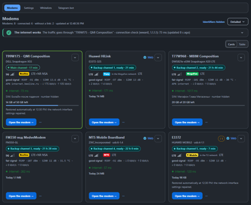</a> <strong>Модемы — главные карточки</strong> Modems — dashboard cards</td>
    <td align="center" width="33%"><a href="02-modem-overview.png">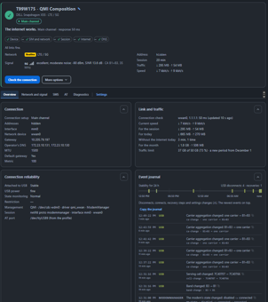</a> <strong>Карточка модема — соединение и события</strong> Modem overview — connection and events</td>
    <td align="center" width="33%"><a href="03-network-signal.png">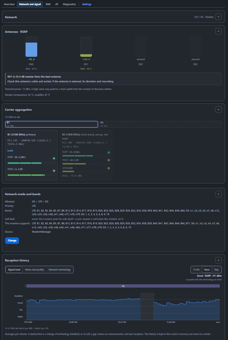</a> <strong>Сеть и сигнал — антенны, агрегация и история</strong> Network and signal — antennas, CA and history</td>
  </tr>
  <tr>
    <td align="center" width="33%"><a href="04-diagnostics-recovery.png">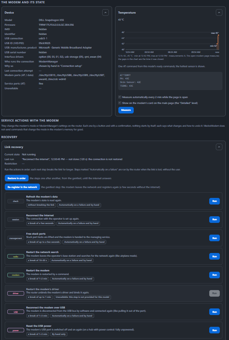</a> <strong>Диагностика — состояние устройства и восстановление</strong> Diagnostics — hardware status and recovery</td>
    <td align="center" width="33%"><a href="05-carrier-aggregation.png">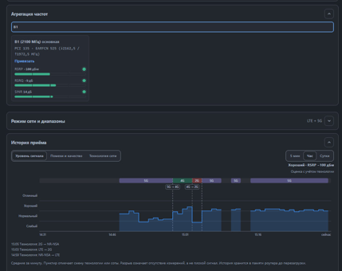</a> <strong>Агрегация частот — LTE B1</strong> Carrier aggregation — LTE B1</td>
    <td align="center" width="33%"><a href="06-usb-tree.png">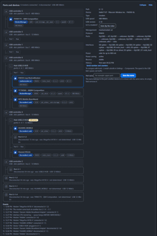</a> <strong>USB-дерево — модемы, порты и подключения</strong> USB device tree — modems and ports</td>
  </tr>
  <tr>
    <td align="center" width="33%"><a href="07-service-status.png">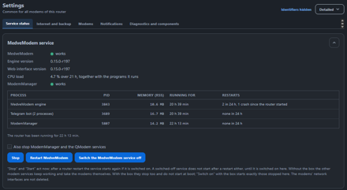</a> <strong>Настройки — состояние службы</strong> Settings — service status</td>
    <td align="center" width="33%"><a href="08-uplink-matrix.png">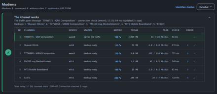</a> <strong>Каналы интернета — кликабельная матрица</strong> Internet uplinks — channel matrix</td>
    <td align="center" width="33%"><a href="09-whitelists.png">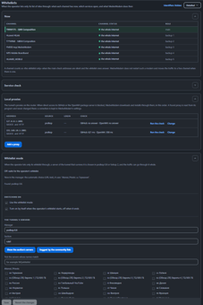</a> <strong>Белые списки — проверка и туннели</strong> Whitelists — checks and tunnels</td>
  </tr>
  <tr>
    <td align="center" width="33%"><a href="10-openwrt-status.png">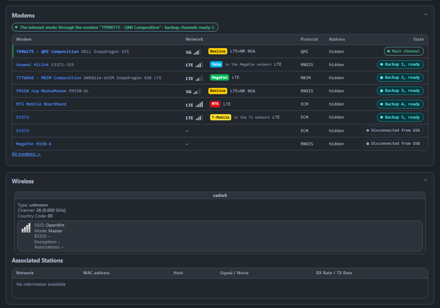</a> <strong>OpenWrt — интеграция в страницу состояния</strong> OpenWrt — status-page integration</td>
    <td align="center" width="33%"><a href="11-modems-table.png">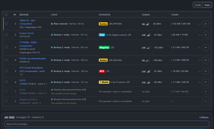</a> <strong>Модемы — табличный режим</strong> Modems — table view</td>
      <td align="center" width="33%"><a href="12-site-access-speed-check.png">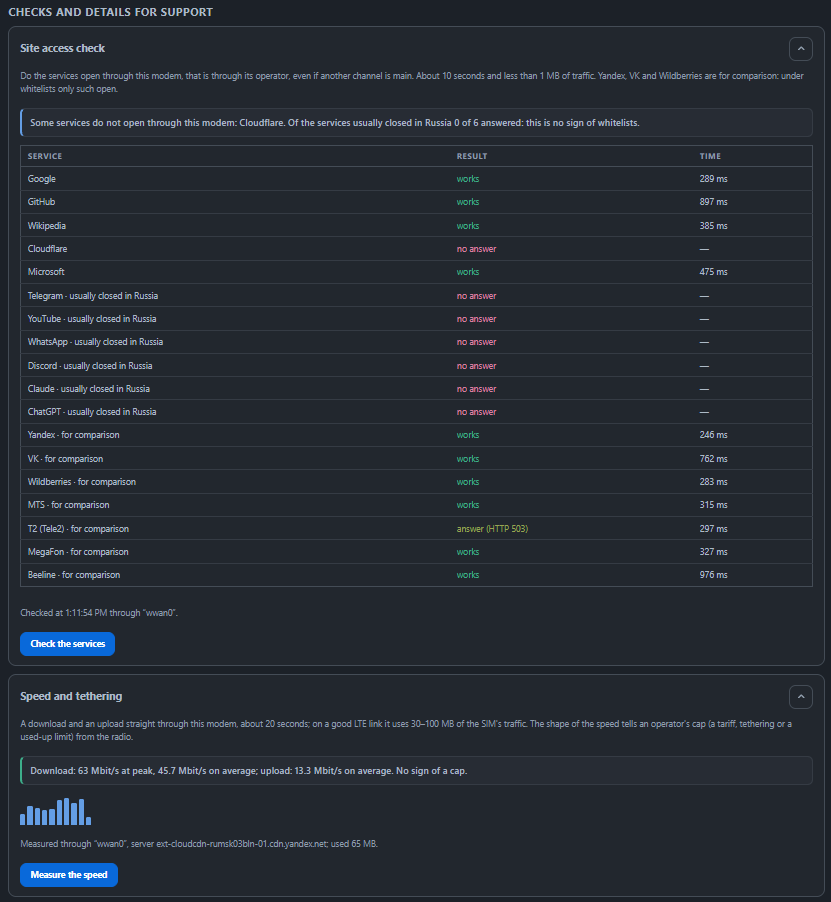</a> <strong>Проверка доступности сервисов и скорости</strong> Site access checks and speed test</td>
</tr>
</table>

## Полные изображения / Full resolution

1. [Модемы — главные карточки / Modems — dashboard cards](01-modems-cards.png)
2. [Карточка модема — соединение и события / Modem overview — connection and events](02-modem-overview.png)
3. [Сеть и сигнал — антенны, агрегация и история / Network and signal — antennas, CA and history](03-network-signal.png)
4. [Диагностика — состояние устройства и восстановление / Diagnostics — hardware status and recovery](04-diagnostics-recovery.png)
5. [Агрегация частот — LTE B1 / Carrier aggregation — LTE B1](05-carrier-aggregation.png)
6. [USB-дерево — модемы, порты и подключения / USB device tree — modems and ports](06-usb-tree.png)
7. [Настройки — состояние службы / Settings — service status](07-service-status.png)
8. [Каналы интернета — кликабельная матрица / Internet uplinks — channel matrix](08-uplink-matrix.png)
9. [Белые списки — проверка и туннели / Whitelists — checks and tunnels](09-whitelists.png)
10. [OpenWrt — интеграция в страницу состояния / OpenWrt — status-page integration](10-openwrt-status.png)
11. [Модемы — табличный режим / Modems — table view](11-modems-table.png)

12. [Проверка сервисов и скорости / Site access and speed test](12-site-access-speed-check.png)
